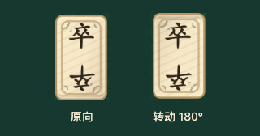

# 莆仙牌桌材质与同席牌带验收

[最初的美术概念](../paper-table/material-study.webp)用于对照墨青织面、深木边沿、花枝牌背、纸边浅纹和画面层次。完整长牌的两端各印一个相同的牌字，下端旋转 180°。三家的暗背读取公开剩余张数，明牌和能向当前玩家公开的鱼沿用牌局已有的分组。

- 开局图从普通练习入口实际进桌，按该局开局实际发牌和电脑行为取图。
- 中盘图在本地测试服务用同一个 `chi_local_upper_zu4` 夹具。桌上来牌为白卒，红兵、黄兵、绿卒已选；三家公开余牌依席位分别为 13、14、12。两版使用同样的名字、明组和流水。
- 基线提交为 `4f5d993`。两版以 Chrome 的原尺寸视口截图。568×320 保留易读的大字自适应，设置中仍可以选长牌。

| 视口 | 开局改动前 | 开局改动后 | 中盘改动前 | 中盘改动后 |
| --- | --- | --- | --- | --- |
| 1440 × 900 | [桌面](before-opening-1440x900.webp) | [桌面](after-opening-1440x900.webp) | [桌面](before-mature-1440x900.webp) | [桌面](after-mature-1440x900.webp) |
| 844 × 390 | [横屏](before-opening-844x390.webp) | [横屏](after-opening-844x390.webp) | [横屏](before-mature-844x390.webp) | [横屏](after-mature-844x390.webp) |
| 568 × 320 | [窄屏](before-opening-568x320.webp) | [窄屏](after-opening-568x320.webp) | [窄屏](before-mature-568x320.webp) | [窄屏](after-mature-568x320.webp) |
| 390 × 844 | [旋转](before-opening-390x844.webp) | [旋转](after-opening-390x844.webp) | [旋转](before-mature-390x844.webp) | [旋转](after-mature-390x844.webp) |

牌背文件与生成方法见[素材清单](../../ASSET_PROVENANCE.md)。Chrome 等待生产 Service Worker 就绪后关闭页面，断开网络再开练习。花枝牌背仍显示，缓存返回 HTTP 200，解码为 192 × 288，响应 SHA-256 与清单一致。

## 另一席观察实际吃牌

在本地好友房以两个 Chrome 上下文分别入座。服务端使用 `chi_collective_confirm` 初始化局面。房主在实际界面选红马、红炮，点击「吃」。另一席监听到 `seat_0 CHI` 后，读到剩余手牌从 5 张降到 3 张，公开区收到 `confirm-target`、`confirm-ma`、`confirm-pao` 各一张，画面中的暗背变为 3 张，明组进入同一席位牌带。这两张图是测试房在动作发生前与落牌时截取的观察端实装。

[吃牌前 844 × 390](observer-before-chi-844x390.webp) · [吃牌后 844 × 390](observer-after-chi-844x390.webp)

## 核对长牌的两个字

从 844 × 390 的 Chrome 练习桌截取当前来牌白卒并放大。左边保留截图原向，右边将同一张截图转动 180°。两端字形各自居中，牌面中央留白。小到容不下两字的公共牌缩略图显示一个牌名。

